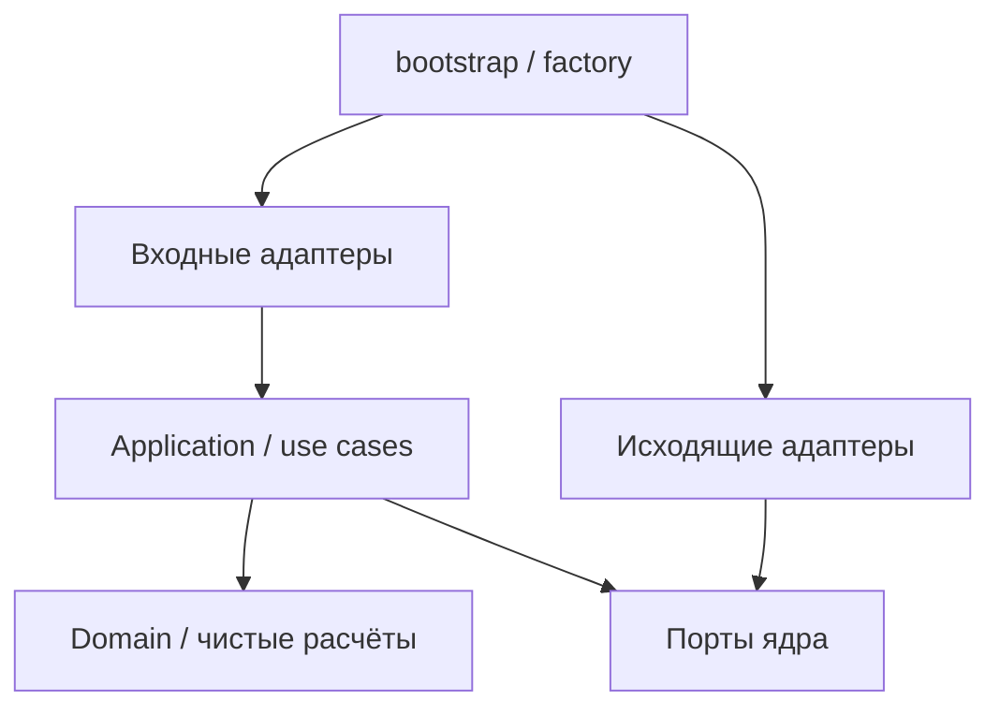

# Фактическая архитектура Personal Wealth

Срез кода М11 от 27.11.2026. Ревизия и актуальная точка продолжения указаны в [status.md](docs/macro-automation/status.md). [Историческое описание](docs/architecture.md) сохраняет ход перехода; этот документ описывает действующую систему.

## Назначение и стек

«Капитал» — локальное однопользовательское веб-приложение: инвестиционные счета и позиции, недвижимость/аренда, доходы, долги, налоги, цели и портфели, исследовательские карточки компаний/криптоактивов, макроэкономика РФ и отраслевые оценки. Оно не исполняет биржевые сделки и не является сервисом подачи налоговых деклараций.

| Часть | Реализация |
|---|---|
| Backend | Python 3.9+, Flask; модульный монолит |
| Frontend | Серверные Jinja-шаблоны, обычный JavaScript, CSS, собственные SVG-графики; нет SPA/Node-сервера или сборщика |
| Хранилище | SQLite в памяти, `PRAGMA user_version=21`; `cryptography` AES-256-GCM и scrypt для файла `invest.enc` |
| Файловый импорт | CSV стандартной библиотеки, `openpyxl` для XLSX, `defusedxml` для XML |
| Проверки | unittest, coverage с ветвлениями, Node test runner, Playwright/Chromium в CI |
| Запуск | `app.py`, `run.sh`, `run.command`, `run.bat`; один процесс-владелец каждого vault |

Фактические диапазоны зависимостей — в [requirements.txt](requirements.txt) и [requirements-dev.txt](requirements-dev.txt). Lock-файла зависимостей нет; не выдавать диапазоны за воспроизводимую фиксацию версий.

## Слои и направления зависимостей

Порты принадлежат ядру, адаптеры их реализуют. Application организует чтение/валидацию/запись; домен не знает сеть, HTTP, SQL, Flask или Vault. Межмодульное переиспользование допустимо через существующие сценарии, порты и чистые функции: например, отрасли используют преобразования макроданных, но имеют независимые веса. Не нужно создавать отдельный сервис или копию модели ради названия из ТЗ.

| Путь | Ответственность |
|---|---|
| [app.py](app.py) | Точка входа и экспорт фабрики, управление runtime в `try/finally` |
| [wealth_manager/factory.py](wealth_manager/factory.py), [bootstrap.py](wealth_manager/bootstrap.py) | Независимый Flask-экземпляр, конфигурация, связывание реализаций |
| [wealth_manager/modules](wealth_manager/modules) | Доменные модели, use cases, порты и read models по предметным областям |
| [wealth_manager/shared](wealth_manager/shared) | Decimal, валидация, ошибки, стабильные классификаторы и общие порты |
| [wealth_manager/adapters/web](wealth_manager/adapters/web) | Маршруты, формы, локализация, security hooks, отображение ошибок |
| [wealth_manager/adapters/persistence](wealth_manager/adapters/persistence) | SQLite-репозитории, миграции, UoW и отсоединённые снимки для чтения |
| [wealth_manager/adapters/macroeconomics](wealth_manager/adapters/macroeconomics), [market_data](wealth_manager/adapters/market_data) | Фиксированные внешние endpoints, контракты, парсеры, защита сессии |
| [wealth_manager/adapters/runtime.py](wealth_manager/adapters/runtime.py) | Потоки автоблокировки и макрообновления, явные start/close |
| [vault.py](vault.py), [db.py](db.py), [calc.py](calc.py) | Шифрованное хранение, схема/цепочка миграций, совместимый фасад расчётов |
| [templates](templates), [static](static), [tests](tests) | UI, клиентские ресурсы и проверки |

`legacy_routes.py` сохраняет lifecycle/auth, часть настроек и экспорта. `calc.py` и `VaultUnitOfWork.take_snapshot` остаются мостами совместимости. Завершение семи архитектурных этапов не означает удаления всех старых файлов; расширять обход ядра через legacy не следует.

## Основные модули и модели данных

| Модули | Модели / хранение и инварианты |
|---|---|
| `entities`, `accounts`, `assets`, `income_sources` | `entities` — общий ID; `financial_accounts`, `assets`, `income_sources` — разные бизнес-сущности. `accounts` — совместимое read-only представление. Тип сущности не меняется |
| `positions`, `cashflows`, `rentals` | `holdings`, `cashflows`, `leases`, `rent_payments`; аренда и полученный доход синхронизируются атомарно |
| `valuation`, `reporting`, `dashboard` | Текущая стоимость, качество цен/курсов, история, XIRR, объединённые отчёты. `rates`, `historical_rates`, `snapshots`; GET-отчёт не создаёт снимок |
| `ledger`, `importing` | Входящие остатки и воспроизведение журнала, отмены, средневзвешенная стоимость, единый CSV v1 и сверка. Включение журнала явное; старые движения не проводятся повторно |
| `liabilities`, `taxes` | Долг и погашение, раздельные проценты/комиссии; налоговые оценки, платежи, возвраты и зашифрованные вложения. Налоговый журнал автоматически не меняет остатки |
| `planning` | `goals`, `portfolios`, `allocations`; одна цель на портфель, доли в базисных пунктах, общий предел 100% актива. Прогноз цели — сценарий, не денежная операция |
| `companies`, `instruments`, `market_catalog` | Компании, криптоактивы, явные `holding_links`; `sectors`, `company_sectors`, `securities`, `security_listings`, история статусов. Компания ≠ выпуск ≠ тикер. `listing_iss_snapshots` хранит сведения ISS по листингу |
| `market_data`, `preferences` | Котировки/FX и настройки языка/страны/выбранных криптобирж |
| `macroeconomics` | Паспорта рядов/источников, артефакты, неизменяемые ревизии, импорт, загрузка/расписание и производные расчёты. Legacy `macro_observations` — представление |
| `economic_cycle` | Версии настроек, пять фаз либо `INSUFFICIENT_DATA`, объяснения и неизменяемые результаты со связями на входные ревизии |
| `macro_dashboard` | Согласованный аналитический read model: KPI, графики, фазы, диагностика, происхождение и статус обновления |
| `sector_scoring` | Независимые профили/веса, ручные агрегаты с источниками и ревизиями, полнота/ликвидность, объяснимый рейтинг 0–100, неизменяемые снимки |

Детальные правила остальных подсистем собраны в [карте завершённых работ](docs/project-history.md); методики макроаналитики — в [плане и документах М1–М11](docs/macro-automation/plan.md). Не переносить отсутствующие компания-метрики из отраслевых агрегатов.

## Хранение, транзакции и численная точность

- Расшифрованная SQLite работает в памяти. Пароль не сохраняется; ключ выводится scrypt. AES-GCM защищает данные и заголовок. `vault.save` пишет зашифрованный `.tmp`, выполняет fsync и `os.replace`; предыдущий файл сохраняется как зашифрованный `.bak`.
- Python с SQLite serialization сохраняет бинарную БД; запасной SQL-dump включает `PRAGMA user_version`, в том числе на Python 3.9. Поддержка обеих форм проверяется тестами. Схема новее поддерживаемой отклоняется.
- `VaultUnitOfWork` под `RLock` делает резервную копию SQLite в памяти. Успех — после commit SQLite **и** сохранения зашифрованного файла; исключение восстанавливает память. Вложенная UoW в открытой транзакции запрещена.
- `db.init_db` последовательно применяет миграции с rollback всей цепочки; при разблокировке новая схема сохраняется до допуска к данным. Миграция 20 → 21 добавляет снимок сведений ISS на листинг. Финансовые остатки сохраняются. Обратной миграции нет.
- Финансовые значения — `Decimal` и TEXT affinity; нельзя суммировать денежные строки через SQL `SUM`/`CAST REAL`. Финансовый контекст — 80 значащих цифр; производные М6 используют свой контекст 50. XIRR — приближённый численный решатель. JSON передаёт точные числа строками; JS Number используется для координат/предпросмотра, не как новое точное хранилище.
- Полнота, давность, отсутствие значения и нулевое значение различаются. Архив скрывает запись в навигации, но не обнуляет капитал. Закрытие счёта — отдельный сценарий. Исторический график активов не является историей чистого капитала.
- Полное копирование/шифрование БД и накопление снимков имеют цену по памяти и времени. Автоматического удаления истории и внешнего plaintext-кэша нет; измерения и изменение политики хранения требуют отдельного объёма.

## Runtime, сеть и конфигурация

Импорт `app` не создаёт Flask/Vault/потоки. `create_app(config=None, *, vault=None)` собирает runtime в `app.extensions['wealth_manager']`. `runtime.start()` запускает автоблокировку и worker макрообновления; `close()` останавливает/ожидает их, сохраняет и блокирует vault. Закрывать runtime нужно вне HTTP-запроса. При ошибке сохранения доступная память сохраняется для повторной попытки.

Обычный HTTP-запрос сериализуется vault `RLock`. Макрозагрузки специально отпускают блокировку на время сети, затем проверяют сессию/истечение idle/версию настроек перед короткой записью. Старый путь котировок позиций может удерживать request lock во время сети. Автоматическое обновление работает только при запущенном приложении и разблокированном vault, не вызывает `touch`, не обходит автоблокировку. Ручное макрообновление пока синхронное; внешний cron и несколько процессов на одном файле не поддержаны.

| Настройка | Место |
|---|---|
| Путь к vault/старой БД | Конфиг `VAULT_PATH`/`LEGACY_DB_PATH`, иначе `INVEST_VAULT`/`INVEST_DB`, иначе файлы рядом с приложением |
| Автоблокировка | `IDLE_MINUTES` / `INVEST_IDLE_MIN`, по умолчанию 15 минут; `AUTOLOCK_POLL_SECONDS` по умолчанию 30 |
| Порт / запуск браузера | `PORT` (5050), `NO_BROWSER` в `app.py` |
| Язык, страна, котировки, расписание | Таблица `settings` внутри vault; `macro_refresh_v1` хранит настройки, checkpoint и ограниченный журнал |
| Настройки моделей | Неизменяемые `economic_cycle_configs` и `sector_configs`, отдельные указатели активной конфигурации |
| Тема | `localStorage` браузера, существующие CSS-токены |

Явный конфиг фабрики имеет приоритет над окружением. Независимым экземплярам нужны разные файлы vault.

## Внешние интеграции и API

| Интеграция | Реальный объём |
|---|---|
| Курсы ЦБ, MOEX-котировки, Binance/Bybit/OKX | Публичные read-only запросы; страна и выбранные криптобиржи ограничивают fallback, USDT≈USD — явно обозначенное приближение |
| ЦБ макро | Проверенные HTML-таблицы ключевой ставки и бескупонной кривой ОФЗ 1/2/5/10Y; исторические даты публикации неизвестны |
| MOEX макро | IMOEX, MCFTR, RGBI, RGBITR, RUSFAR; ISS с проверкой страниц/идентичности. Доступ и расписания по умолчанию выключены; выбранный режим не заменяет договор |
| MOEX Company Explorer | Ручной запрос TQBR с проверкой идентичности, статический каталог и датированные котировки. [Границы М11](docs/macro-automation/M11-company-explorer.md) |
| Статистические файлы | До пяти CSV/XLSX с явным паспортом/сопоставлением и подтверждением; это не универсальный парсер любого отчёта Росстата |
| Росстат / фундаментальные данные | Автоадаптер Росстата не подключён; М10 принимает ручные отраслевые агрегаты. PMI и автоfundamentals не реализованы |

Даты проверок источников и лимиты — в документах М3–М5. Их HTTP-успех в прошлом не является мониторингом доступности сегодня. Открытие макроотчётов не вызывает сеть. Исключение среди других читающих endpoints: `/api/cbr?cur=...&date=...` явно запрашивает исторический курс для UI; нельзя обобщать запрет сети на весь HTTP GET.

Основной контракт — серверные HTML-страницы и POST-формы, не отдельный публичный REST API/OpenAPI. Существующие семейства маршрутов:

| Область | Точки входа |
|---|---|
| Сессия и общий UI | `/setup`, `/unlock`, `/lock`, `/`, `/settings`, `/accounts/<id>`, `/assets/<id>`, `/income-sources/<id>` |
| Учёт | `/operations`, `/income`, `/portfolios`, `/liabilities`, `/taxes`; точные команды в соответствующих web-адаптерах |
| Компании | `/companies` с GET-фильтрами, `/companies/<id>`, `/companies/sectors`, `/securities/<id>`. POST для статуса наблюдения и обновления ISS в существующих карточках |
| Макроданные | `/macroeconomics`, `/macroeconomics/data`, `/macroeconomics/import`, `/macroeconomics/calculations` |
| Модели и UI | `/macroeconomics/dashboard`, `/macroeconomics/cycle`, `/macroeconomics/sectors`, `/settings/economic-cycle`, `/settings/sector-scoring` |

Полный перечень — регистрации в [factory.py](wealth_manager/factory.py) и web-адаптерах. Новые read models не должны выдавать ORM/соединение наружу; точные формы и HTTP-ошибки проверяются тестами.

## Локализация, безопасность и границы расширения

Русский — исходный язык, `_('...')` и `locales/en.json` дают английский. JS получает каталог через `tojson`; пользовательские подписи экранируются/выводятся текстовыми узлами. Коды встроенных категорий стабильны и отделены от пользовательских строк. В подписанной сессии сохраняется язык заблокированного UI; после разблокировки берётся настройка vault.

Приложение слушает только loopback, один владелец vault. Случайный ключ Flask создаётся на экземпляр; cookie HttpOnly и SameSite=Strict, сессия сверяется с токеном разблокировки. Это локальная модель доступа, не готовая многопользовательская публикация в интернет. Полный аудит безопасности в данной передаче не заявляется. Экспорт CSV и скачанные вложения выходят из шифрованного файла; README описывает этот предел. Восстановления забытого пароля нет. Файловые импорты и ответы поставщиков ограничены и проверяются; секреты провайдеров не нужны действующим публичным адаптерам.

Запланированы, но не реализованы: М11 Company Explorer и подтверждённая интеграция справочника MOEX при необходимости, М12 историческая проверка/чувствительность/производительность; автоматический Росстат остаётся открытым остатком М4. Не считать синтетические сценарии калибровкой на истории. Отдельные экраны фундаментального/технического анализа, корпоративные действия и внешнее хранилище не обещаны как готовые. Точный backlog — [план](docs/macro-automation/plan.md) и [история подсистем](docs/project-history.md).
